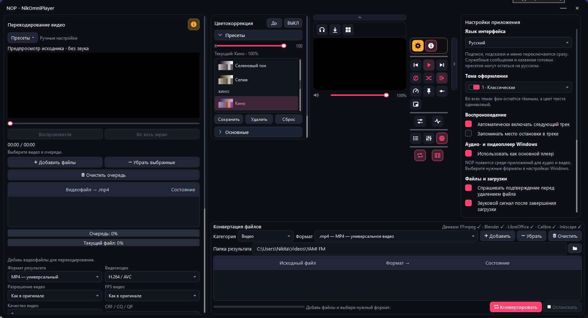

<div align="center">

# NOP — NikOmniPlayer

**A local audio/video player with built-in downloads, a system-wide equalizer, color correction and file conversion.**

[English](README.md) · [Русский](README.ru.md)


[**⬇ Download the installer**](https://github.com/ChebNikit/NOP/releases/latest)



</div>

---

## Why NOP

One app instead of five: play your media, download new media, tune the sound, fix the picture and convert files — all in one small window.

## Features

- **Player** — audio and video, track list with search and filters, repeat one / shuffle / sequential, playback speed 0.5×–2×, remembers your position.
- **Downloads** — YouTube, TikTok, Instagram, Spotify and direct HTTP(S) links. Separate video resolution/profile and audio quality, `cookies.txt` support, a dedicated progress panel with speed, size and stage.
- **Equalizer** — two modes: *NOP only* (audio and video inside the player) or *Whole device* through [Equalizer APO](https://sourceforge.net/projects/equalizerapo/), so your browser and other apps get the same sound. Presets, custom bands, save/delete your own.
- **Video** — color correction, fullscreen with auto-hiding controls, and a compact **video-only mode** (256×144, always on top) toggled with a middle click on the video.
- **Video transcoding panel** (`Ctrl+Shift+T`) — re-encode videos to H.264, H.265/HEVC or VP9 in MP4, MOV, MKV, WebM or AVI at 720p, 1080p, 2K or 4K, with a choice of audio codec (AAC, Opus, MP3, FLAC, PCM or copy), hardware encoders (NVIDIA NVENC, Intel Quick Sync, AMD AMF), a preview, and pause/resume.
- **Converter** — convert audio and video with a live preview, plus documents, vector graphics, e-books and 3D models through bundled engines (FFmpeg, LibreOffice, Inkscape, calibre, Blender) in the installer build.
- **Customization** — Russian / English interface, five color themes (*Classic*, *Cosmic + Vanilla*, *Lavender + Violet*, *Jet Black / Orchid*, *Wine Ash / Turquoise*), independent panels you can show or hide.
- **Layout profiles** — "Listen", "Download" and "All" switch the set of panels in one click.

## Install (Windows 10 1809+ / Windows 11, x64)

1. Open the [**Releases**](https://github.com/ChebNikit/NOP/releases/latest) page.
2. Download the latest `NOP_Setup.exe`.
3. Run it and follow the installer.

> Windows 7 and 8 are not supported.

## Run from source

```bash
git clone https://github.com/ChebNikit/NOP.git
cd NOP
pip install -r requirements.txt
```

You also need **ffmpeg** and **deno** on your system:

```bash
winget install ffmpeg
winget install DenoLand.Deno
```

For the best video playback NOP uses **libmpv** (the mpv library); if it is not found, the player falls back to the built-in Qt/FFmpeg path.

Then start it:

```bash
python NOP_1.0.py
```

## Build the Windows installer

The repository contains the full build kit. You need Windows 10/11 x64, Windows PowerShell 5.1 and at least **18 GiB** of free disk space (25 GiB recommended). No global Python, FFmpeg, mpv or Inno Setup is required: the kit prepares everything itself from pinned, hash-checked archives. Windows may ask for UAC consent to install the Visual C++ runtime.

```bat
build_windows.bat
```

Wait for `CREATED`. The installer is written to `release\NOP_Setup.exe`, next to a `CONVERTER_COMPACTION_REPORT.json` with the final size and the trimmed components.

To use another drive for the work folder (default `%LOCALAPPDATA%\NOPBK\R12`; the path must be local and at most 110 characters):

```bat
set "NOP_BUILD_WORKSPACE=D:\NOPBK\R12"
build_windows.bat
```

Large third-party files (FFmpeg, libmpv, deno, Python wheels) are **not** stored in this repository. A complete offline copy of the kit is attached to the release as `NOP_BuildKit_R12.zip`. Publish the finished installer in **Releases**, not in the repository.

## Hotkeys

| Key | Action |
|---|---|
| `Space` | Pause / resume |
| `← / →` | Seek 5 seconds |
| `F11` | Fullscreen on / off |
| `Esc` | Exit video mode, or close the app |
| `Ctrl+T` | Track list |
| `Ctrl+E` | Equalizer |
| `Ctrl+D` | Download settings |
| `Ctrl+Shift+D` | Downloads progress panel |
| `Ctrl+Shift+V` | File converter |
| `Ctrl+Shift+T` | Video transcoding panel |
| `Ctrl+Shift+C` | Color correction |
| `Ctrl+S` | Seek bar |
| `Ctrl+H` | Button and volume panel |
| `Ctrl+R` | Window size panel |
| `Ctrl+P` | Always on top |
| `Ctrl+M` | Move window to screen center |
| `Ctrl+,` | App settings (language, theme) |
| `F1` | About |
| Right click | Context menu |
| Middle click on video | Compact video-only mode |

## Using the downloader

- Pick a service and link type, choose a folder and quality, then press the red **Download** button.
- Some sites require login: export your browser cookies to `cookies.txt` (for example with the *Get cookies.txt LOCALLY* extension) and select the file in the download settings.
- Spotify needs your own **Client ID** and an authorization step; the format and bitrate are set separately.
- Availability and quality depend on each service and can change over time. Downloads are handled by [yt-dlp](https://github.com/yt-dlp/yt-dlp) and [FFmpeg](https://github.com/FFmpeg/FFmpeg).

## Disclaimer

NOP is meant for personal use. You are responsible for what you download and for respecting the terms of the services and the rights of content owners in your country.

## Built with

[PyQt6](https://www.riverbankcomputing.com/software/pyqt/) · [yt-dlp](https://github.com/yt-dlp/yt-dlp) · [FFmpeg](https://ffmpeg.org/) · [libmpv](https://mpv.io/) · [Equalizer APO](https://sourceforge.net/projects/equalizerapo/)

## License

Distributed under the **GNU GPL v3**. See [LICENSE](LICENSE).

## Author

Made by **Nik**. If NOP is useful to you, star the repository and share it with a friend. ⭐
