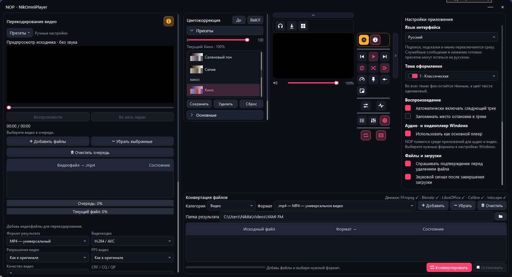

<div align="center">

# NOP — NikOmniPlayer

**Локальный аудио- и видеоплеер со встроенными загрузками, системным эквалайзером, цветокоррекцией и конвертацией файлов.**

[English](README.md) · [Русский](README.ru.md)


[**⬇ Скачать установщик**](https://github.com/ChebNikit/NOP/releases/latest)



</div>

---

## Зачем NOP

Одно приложение вместо пяти: воспроизводит ваши файлы, скачивает новые, настраивает звук, правит картинку и конвертирует файлы — всё в одном компактном окне.

## Возможности

- **Плеер** — аудио и видео, список треков с поиском и фильтрами, повтор одного трека, случайный и последовательный порядок, скорость 0.5×–2×, запоминание позиции.
- **Загрузки** — YouTube, TikTok, Instagram, Spotify и прямые HTTP(S)-ссылки. Отдельный выбор разрешения и профиля видео и качества звука, поддержка `cookies.txt`, отдельная панель прогресса со скоростью, объёмом и этапом.
- **Эквалайзер** — два режима: *«Только NOP»* (звук и видео внутри плеера) или *«Всё устройство»* через [Equalizer APO](https://sourceforge.net/projects/equalizerapo/): тот же звук получают браузер и другие приложения. Пресеты, свои полосы, сохранение и удаление собственных настроек.
- **Видео** — цветокоррекция, полноэкранный режим с автоскрытием элементов управления и компактный режим **«Только видео»** (256×144, поверх всех окон), который включается нажатием колёсика на видео.
- **Панель перекодирования видео** (`Ctrl+Shift+T`) — перекодирование в H.264, H.265/HEVC или VP9 в контейнеры MP4, MOV, MKV, WebM или AVI с разрешением 720p, 1080p, 2K или 4K, выбор аудиокодека (AAC, Opus, MP3, FLAC, PCM или копирование), аппаратные кодировщики (NVIDIA NVENC, Intel Quick Sync, AMD AMF), предпросмотр, пауза и продолжение.
- **Конвертер** — аудио и видео с предпросмотром, а также документы, векторная графика, электронные книги и 3D-модели через встроенные движки (FFmpeg, LibreOffice, Inkscape, calibre, Blender) в версии из установщика.
- **Под себя** — интерфейс на русском и английском, пять цветовых тем (*Классическая*, *Cosmic + Vanilla*, *Lavender + Violet*, *Jet Black / Orchid*, *Wine Ash / Turquoise*), независимые панели, которые можно показывать и скрывать.
- **Профили раскладки** — «Слушать», «Скачивать» и «Всё» меняют набор панелей одним нажатием.

## Установка (Windows 10 1809+ / Windows 11, x64)

1. Откройте страницу [**Releases**](https://github.com/ChebNikit/NOP/releases/latest).
2. Скачайте последний `NOP_Setup.exe`.
3. Запустите и следуйте подсказкам установщика.

> Windows 7 и 8 не поддерживаются.

## Запуск из исходников

```bash
git clone https://github.com/ChebNikit/NOP.git
cd NOP
pip install -r requirements.txt
```

Дополнительно нужны **ffmpeg** и **deno**:

```bash
winget install ffmpeg
winget install DenoLand.Deno
```

Для лучшего воспроизведения видео NOP использует **libmpv** (библиотеку mpv). Если её нет, плеер переключается на встроенный путь через Qt/FFmpeg.

Запуск:

```bash
python buildkit/source/NOP_1_2.py
```

## Сборка установщика для Windows

Набор для сборки лежит в папке [`buildkit/`](buildkit). Нужны Windows 10 (1809+) или Windows 11 x64, интернет при первой сборке и около 25 ГБ свободного места (около 8 ГБ без движков конвертации). Заранее ничего ставить не нужно: набор сам скачивает личный Python, библиотеки и компоненты, проверяет каждую загрузку по закреплённым SHA-256 и ничего не меняет в системе.

```bat
cd buildkit
BUILD_NOP_SETUP.bat
```

Установщик появится в `buildkit\dist\NOP_Setup.exe`, рядом — файл `.sha256` и `BUILD_REPORT.json`. Перед созданием установщика собранная программа проходит самопроверку; если она не пройдена, установщик не создаётся. Полезные параметры: `--no-engines` (облегчённый установщик без конвертеров документов, векторной графики, книг и 3D), `--offline`, `--clean`, `--from-step N`, `--verify-install` (только на тестовом ПК). Подробности и решение проблем — в [`buildkit/README.md`](buildkit/README.md), что проверено и что нет — в [`buildkit/docs/VERIFICATION.md`](buildkit/docs/VERIFICATION.md).

Исходник программы — `buildkit/source/NOP_1_2.py`. Чтобы собрать из собственной изменённой копии: `BUILD_NOP_SETUP.bat --source "C:\путь\к\NOP.py"`. В установщик также входит [Equalizer APO](https://sourceforge.net/projects/equalizerapo/) 1.4.2 для режима эквалайзера *«Всё устройство»*: сборка скачивает его, проверяет закреплённый SHA-256 и встраивает, а `NOP_Setup.exe` запускает его, если APO ещё не установлен (Windows запросит права администратора, а мастер APO попросит выбрать устройство звука). Готовый установщик публикуйте в разделе **Releases**, а не в самом репозитории.

## Горячие клавиши

| Клавиша | Действие |
|---|---|
| `Пробел` | Пауза / продолжить |
| `← / →` | Перемотка на 5 секунд |
| `F11` | Во весь экран / обратно |
| `Esc` | Выйти из видеорежима или закрыть приложение |
| `Ctrl+T` | Список треков |
| `Ctrl+E` | Эквалайзер |
| `Ctrl+D` | Настройки загрузки |
| `Ctrl+Shift+D` | Панель прогресса загрузок |
| `Ctrl+Shift+V` | Конвертер файлов |
| `Ctrl+Shift+T` | Панель перекодирования видео |
| `Ctrl+Shift+C` | Цветокоррекция |
| `Ctrl+S` | Ползунок перемотки |
| `Ctrl+H` | Панель кнопок и громкости |
| `Ctrl+R` | Панель размера окна |
| `Ctrl+P` | Поверх всех окон |
| `Ctrl+M` | Переместить окно в центр экрана |
| `Ctrl+,` | Настройки приложения (язык, тема) |
| `F1` | О приложении |
| Правая кнопка | Контекстное меню |
| Колёсико по видео | Компактный режим «Только видео» |

## Как пользоваться загрузчиком

- Выберите сервис и тип ссылки, папку и качество, затем нажмите красную кнопку **«Скачать»**.
- Для некоторых сайтов нужен вход: экспортируйте cookies браузера в `cookies.txt` (например, расширением *Get cookies.txt LOCALLY*) и укажите файл в настройках загрузки.
- Для Spotify нужны ваш собственный **Client ID** и авторизация; формат и битрейт задаются отдельно.
- Доступность и качество зависят от сервиса и со временем могут меняться. Загрузки выполняют [yt-dlp](https://github.com/yt-dlp/yt-dlp) и [FFmpeg](https://github.com/FFmpeg/FFmpeg).

## Отказ от ответственности

NOP предназначен для личного использования. Вы сами отвечаете за то, что скачиваете, и за соблюдение правил сервисов и прав владельцев контента в вашей стране.

## Использует

[PyQt6](https://www.riverbankcomputing.com/software/pyqt/) · [yt-dlp](https://github.com/yt-dlp/yt-dlp) · [FFmpeg](https://ffmpeg.org/) · [libmpv](https://mpv.io/) · [Equalizer APO](https://sourceforge.net/projects/equalizerapo/)

## Лицензия

Распространяется под лицензией **GNU GPL v3**. См. [LICENSE](LICENSE).

## Поддержать проект

NOP бесплатный и с открытым исходным кодом. Если он вам полезен, вы можете поддержать его развитие:

<table>
<tr>
<td align="center"><br><b>Ethereum</b></td>
<td align="center"><br><b>Ozon Банк (СБП)</b></td>
</tr>
</table>

- **Ethereum** (ETH и токены ERC-20 в сети Ethereum): `0x5EDfAbe50567aD88b7bA3138E369a780Eb513A2C`
- **Ozon Банк** (СБП, для счетов в российских банках): https://finance.ozon.ru/apps/sbp/ozonbankpay/01a162fe-be3f-7ff3-8cc6-7659ed88b12c

## Автор

Сделал **Nik**. Если NOP вам пригодился, поставьте звезду репозиторию и расскажите друзьям. ⭐
